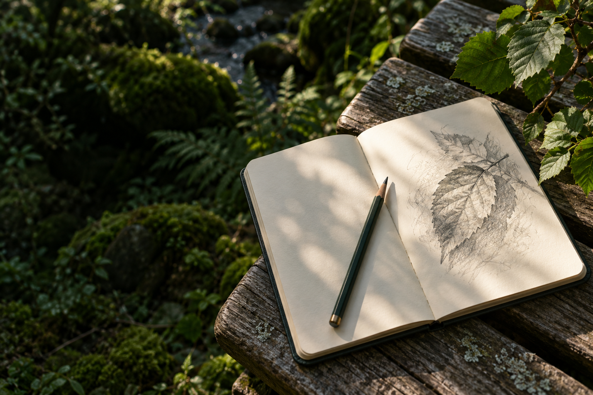

# SketchWild

### Step outside. Draw on paper. Notice one more detail.

SketchWild is an outdoor sketching companion that turns a short walk, a garden visit, or a few minutes on a balcony into an observation exercise. Choose something in nature, sketch it on paper, and compare a photograph of the subject with your drawing using **Gemma 3 through Ollama**. The model offers a small, specific invitation to look again. Your sketches and reflections become a personal field journal stored in your browser.

Built for the **Hacktoberfest Open-Source AI Challenge — Week 1: Touch Grass**.



*Illustrative artwork generated for the interface; not a participant photograph.*

## Why SketchWild?

It can be difficult to know what to draw outside—or what to notice once you start. SketchWild gives beginners, nature journalers, and people looking for a short outdoor break a concrete starting point: a subject, a manageable exercise, and one detail to revisit.

You draw with a pencil on paper. The app provides the prompt before you go and a moment of reflection afterward. It works with leaves, flowers, trees, bark, rocks, and whole outdoor scenes, so you can use what is around you rather than search for a particular plant.

The AI's role is observation coaching. It compares the two uploaded pictures and suggests a next look; it does not generate your drawing, assign an art grade, or identify a species.

## A session, from start to finish

1. **Pick an outdoor exercise.** Choose a subject directly, or browse missions by place and available time.
2. **Head outside and draw.** Follow the prompt on paper. Printable mission instructions let you take the exercise with you.
3. **Upload two pictures.** Add a photograph of your subject and a photograph of your paper sketch. Preview and rotate them before requesting feedback.
4. **Get an observation.** The open-weight vision model compares the pair and returns structured feedback grounded in the pictures, with an invitation to inspect one detail again.
5. **Take a second look.** Add a reflection and, optionally, another sketch. You can also mark the feedback helpful, unclear, or inaccurate.
6. **Save your field journal.** Return to earlier subjects, compare attempts, and export your journal with its images.

For example, after sketching a flower, you might revisit the shape of a curved petal or the spaces between petals. The actual suggestion depends on the uploaded pictures and the model's response.

## What you can do

| Feature | What it gives you |
| --- | --- |
| **Six subject categories** | Exercises for leaves, flowers, trees, bark, rocks, and outdoor scenes. |
| **Outdoor missions** | Six designed exercises exploring shapes, overlap, texture, light, negative space, and depth, with place/time filters and printable instructions. |
| **Photo-and-sketch coaching** | A comparison of your subject and paper drawing using a local open-weight vision model. Unclear inputs can produce an uncertainty or retake response. |
| **Second looks** | Reflections, optional follow-up sketches, and linked revisits to a previous subject. |
| **Field Passport** | Mission stamps and four participation milestones: a first outdoor sketch, three subjects, five second looks, and all six missions. |
| **Personal journal** | Browser-local drafts, category filters, before/after views, deletion controls, and ZIP exports containing images and JSON. |
| **Responsive interface** | Desktop and mobile layouts, keyboard-accessible controls, readable subject colors, and reduced-motion support. |

Passport rewards require both pictures and your confirmation that you completed the session outdoors. This is self-reported participation; repeated completions do not create duplicate mission stamps. The next mission is selected from unfinished exercises using app logic.

## Open-weight AI at the core

SketchWild's personalized picture feedback uses **Gemma 3 4B**, a vision-capable open-weight model, through **Ollama**. The model receives the subject photograph and sketch photograph as separate inputs, along with the selected category and observation focus. The server validates the returned structure before displaying the coaching card.

This approach makes several useful things possible:

- **Local inference without an API key.** Once the app and model are downloaded, the comparison can run on your own computer without a cloud inference service.
- **Control over your pictures.** With the default local configuration, inference goes to Ollama on your laptop. The journal stays in your browser.
- **A model you can change.** You can switch to another compatible vision model, edit the coaching prompt, and inspect the application code.
- **A hosted option.** The same app can use an OpenAI-compatible endpoint serving an open-weight vision model when you need a public deployment.

“OpenAI-compatible” refers to the endpoint format. Local mode does not require an OpenAI account or key. Gemma's model terms are separate from the application's MIT license.

The authored outdoor exercises and passport work independently of model inference. If inference fails, the app displays the error; it never silently replaces a live result with an example card.

## Run it on your laptop

### Requirements

- **Node.js 22.18 or newer** and npm.
- **[Ollama](https://ollama.com/)** running locally.
- Enough memory and disk space for the selected model. A dedicated GPU is optional; CPU inference is supported but can be slow.
- Internet for the initial dependency and model downloads.

### 1. Get the code

```sh
git clone https://github.com/priy-anshugupta/sketchwild.git
cd sketchwild
npm ci
```

### 2. Download the vision model

```sh
ollama pull gemma3:4b
```

Keep Ollama running. Use a vision-capable model: a text-only model cannot compare your pictures.

### 3. Create the environment file

In Windows Command Prompt or PowerShell:

```powershell
copy .env.example .env
```

On macOS or Linux, use `cp .env.example .env`.

The included defaults are ready for local Gemma inference:

```dotenv
AI_PROVIDER=ollama
AI_MODEL=gemma3:4b
OLLAMA_BASE_URL=http://127.0.0.1:11434
```

### 4. Start SketchWild

```sh
npm run dev
```

Open **[http://127.0.0.1:5173](http://127.0.0.1:5173)**. Keep the development terminal and Ollama running while you use the app. The frontend forwards API requests to the local server on port 3001.

**Allow time for feedback on a CPU.** One recorded Gemma comparison on the development laptop took approximately **146 seconds**. That is a single sample measurement, not a general speed benchmark. The default local request timeout is five minutes.

### Try the upload flow

You can use the included [sample images](demo-images) to check the workflow:

| Exercise | Subject picture | Paper sketch |
| --- | --- | --- |
| Leaves | [Leaf reference](demo-images/01-leaf-reference.png) | [Leaf sketch](demo-images/02-pencil-sketch.png) |
| Flowers | [Flower reference](demo-images/03-flower-reference.png) | [Flower sketch](demo-images/04-flower-pencil-sketch.png) |

These are generated testing examples. For a real outdoor session, take your own subject photograph and sketch on paper.

## Architecture and stack

```text
React interface
  ├── IndexedDB: drafts, journal entries, and images
  └── Express API: image preparation and response validation
        ├── Ollama → local Gemma 3 vision inference
        └── OpenAI-compatible endpoint → hosted vision inference
```

| Layer | Technology |
| --- | --- |
| Interface | React 19, TypeScript, Vite, Lucide icons |
| Server | Node.js, Express, Zod |
| Image processing | Browser image normalization and Sharp on the server |
| AI | Ollama with Gemma 3 4B; configurable hosted adapter |
| Journal and export | IndexedDB through `idb`; ZIP export through `fflate` |
| Deployment | Render blueprint for the app server; hosted inference configured separately |

## Build, checks, and deployment

```sh
npm test          # Contract, adapter, HTTP upload, and passport checks
npm run build     # TypeScript checking and production frontend build
npm start         # Serve the built app and API together on port 3001
```

After building, open **[http://127.0.0.1:3001](http://127.0.0.1:3001)** for the single-server version.

The repository includes a [Render blueprint](render.yaml). For a public deployment, configure a hosted vision endpoint and keep its key in the server environment. The blueprint's small paid app service does not run Gemma locally; inference runs separately. Render credits and an external inference provider's charges are separate.

The Blueprint defaults to **public preview mode** (`AI_PROVIDER=disabled`), which needs no model API key. Visitors can use missions, uploads, reflections, and the journal; live coaching is disabled with a clear local-setup link and labelled example. Set `DEMO_VIDEO_URL` to your HTTPS walkthrough link to show the video button. Live hosted inference is an optional upgrade.

See **[DEPLOYMENT.md](DEPLOYMENT.md)** for the preview deployment steps, local production setup, hosted configuration, and deployment checks. A public hosted deployment has not yet been created.

## Privacy and practical limits

- **Your journal is stored in this browser.** It has no account or cloud synchronization. Clearing site data removes it; export a ZIP to keep a backup. A different device or site origin has a separate journal.
- **Requesting feedback sends the selected pair for inference.** The server processes the two images, category, and focus. It re-encodes images to remove metadata and does not intentionally save uploads or log image content. Hosted mode is also subject to the chosen provider's policy.
- **Local inference can work without internet after setup.** Full installable PWA caching is not implemented. External fonts have system fallbacks.
- **Pictures have limits.** Upload JPEG, PNG, or WebP files up to 8 MB each. Server-side validation also limits decoded dimensions and rejects animated/multi-page inputs.
- **Feedback is experimental.** A valid response format does not prove visual accuracy. Check the suggestion against your subject; the model may overlook or misinterpret details.
- **Public hosting needs operational care.** Concurrency and request caps are included, but they are in-memory limits that reset when the server restarts. They are not user authentication or a durable billing guard.

More details are in **[SECURITY.md](SECURITY.md)** and **[DEPLOYMENT.md](DEPLOYMENT.md)**.

## What has been verified

The current build passes **17 automated tests**, TypeScript checking, and the production build. The tests cover application contracts and behavior, including an HTTP upload flow using mock inference and a preview-mode check that rejects AI requests without accepting uploads. A live local Gemma request has also returned a coaching card for a sample flower-and-sketch pair.

These checks establish working application plumbing and a live sample comparison. Accuracy across all six categories and benefits for real outdoor users still need evaluation. The repository includes an [evaluation guide](evaluation/README.md) and runner for recording picture-pair results. See **[BUILD-STATUS.md](BUILD-STATUS.md)** for detailed findings and remaining work.

## Documentation and contributions

- [Product requirements and challenge plan](SketchWild-PRD.md)
- [Deployment guide](DEPLOYMENT.md)
- [Build status and inference findings](BUILD-STATUS.md)
- [Evaluation guide](evaluation/README.md)
- [Contributing guide](CONTRIBUTING.md)
- [Security and data handling](SECURITY.md)

Useful contributions include better observation prompts, accessible interface improvements, and carefully documented tests with real subject photographs and paper drawings.

## Inspiration and license

Research inspirations include [Bio Sketchbook (2021)](https://chaozhang.design/assets/biosketchbook_idc21.4a27be43.pdf) and [John Muir Laws' nature journaling practices](https://johnmuirlaws.com/in-discussion-anna-mason-and-john-muir-laws/). SketchWild's implementation, interface, and exercise prompts are original. The decorative banner and bundled sample images were generated for illustration and testing.

Application code is available under the **[MIT license](LICENSE)**. Model weights, fonts, icons, and other dependencies retain their own licenses and terms.
